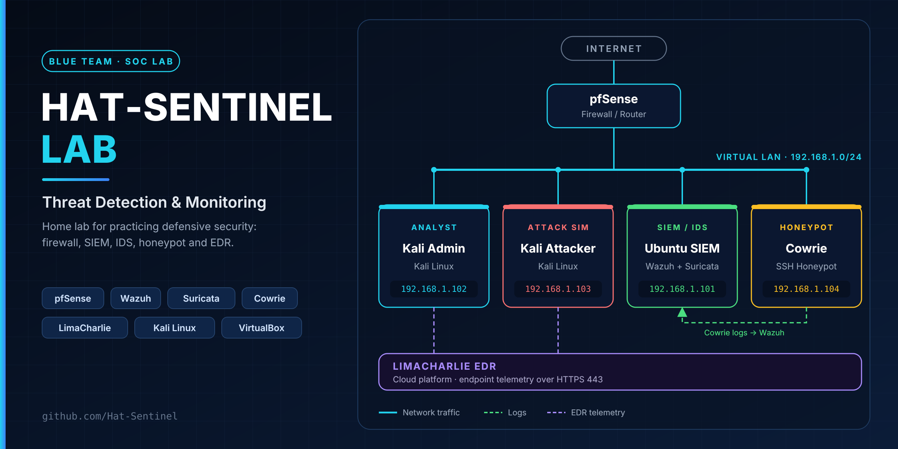
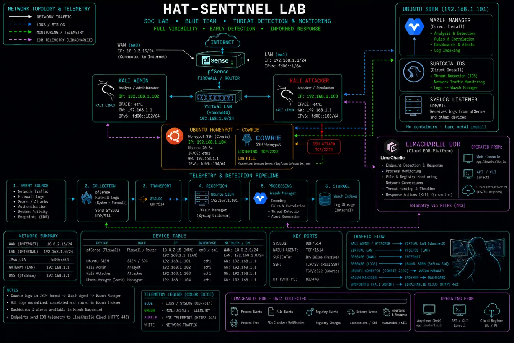

# HAT-SENTINEL | SOC Home Lab

**Threat Detection & Monitoring | Blue Team | Cybersecurity**

Virtual SOC home lab architecture featuring pfSense, Wazuh SIEM, Suricata IDS, Cowrie Honeypot, LimaCharlie EDR, and Kali Linux.

## Network Topology

